# Retro Patterns — Page 1

[Home](README.md) · [1](page1.md) · [2](page2.md) · [3](page3.md) · [4](page4.md) · [5](page5.md) · [6](page6.md)

  <a href="BMP/tile_020.bmp?raw=1">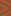</a> <a href="BMP/tile_60square.bmp?raw=1">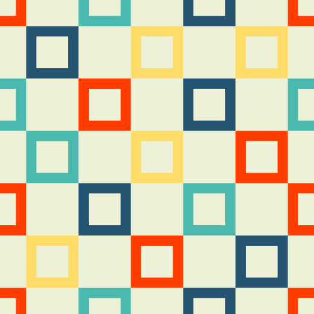</a>  <a href="BMP/tile_091.bmp?raw=1">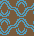</a> <a href="BMP/tile_098.bmp?raw=1">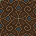</a>      <a href="BMP/tile_156.bmp?raw=1">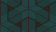</a> <a href="BMP/tile_256color.bmp?raw=1">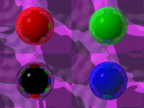</a> <a href="BMP/tile_abstracted.bmp?raw=1">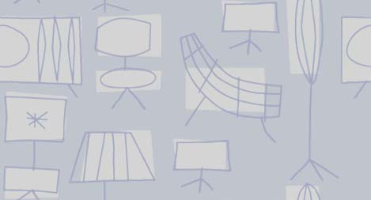</a> <a href="BMP/tile_alhambra.bmp?raw=1">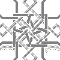</a> <a href="BMP/tile_arabic_floor.bmp?raw=1">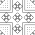</a> <a href="BMP/tile_arabic_rect.bmp?raw=1">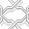</a>  <a href="BMP/tile_arabic_star.bmp?raw=1">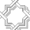</a>   <a href="BMP/tile_autumn.bmp?raw=1">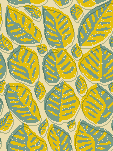</a>   <a href="BMP/tile_ball.bmp?raw=1">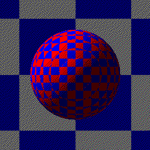</a> <a href="BMP/tile_balls.bmp?raw=1">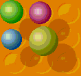</a> <a href="BMP/tile_bamboo.bmp?raw=1">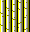</a>       <a href="BMP/tile_bluegrid.bmp?raw=1">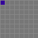</a>       <a href="BMP/tile_boiling.bmp?raw=1">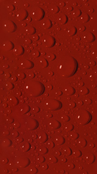</a> <a href="BMP/tile_bones.bmp?raw=1">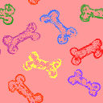</a> <a href="BMP/tile_bowtile_line.bmp?raw=1">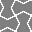</a>  <a href="BMP/tile_brain.bmp?raw=1">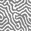</a>          <a href="BMP/tile_brick.bmp?raw=1">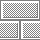</a>   <a href="BMP/tile_bricks.bmp?raw=1">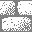</a>  <a href="BMP/tile_bubbles.bmp?raw=1">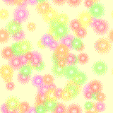</a>  <a href="BMP/tile_bumps2.bmp?raw=1">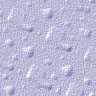</a> <a href="BMP/tile_burgers.bmp?raw=1">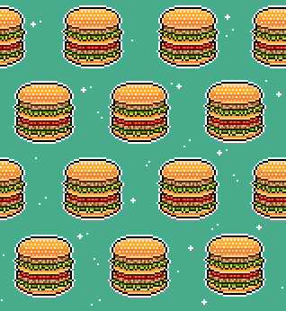</a>  <a href="BMP/tile_buttons16.bmp?raw=1">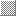</a> <a href="BMP/tile_buttons19.bmp?raw=1">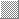</a> <a href="BMP/tile_buttons64.bmp?raw=1">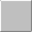</a> <a href="BMP/tile_buzz.bmp?raw=1">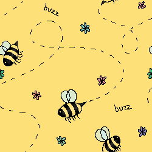</a>  <a href="BMP/tile_cane_fancy.bmp?raw=1">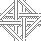</a> <a href="BMP/tile_cane_fancy2.bmp?raw=1">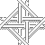</a> <a href="BMP/tile_cane_seat.bmp?raw=1">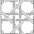</a> <a href="BMP/tile_cane_square.bmp?raw=1">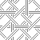</a> <a href="BMP/tile_cane_true.bmp?raw=1">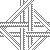</a> <a href="BMP/tile_carbon.bmp?raw=1">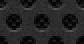</a> <a href="BMP/tile_cardback.bmp?raw=1">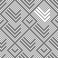</a>  <a href="BMP/tile_carved.bmp?raw=1">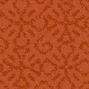</a> <a href="BMP/tile_charlie.bmp?raw=1">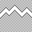</a>    <a href="BMP/tile_checkers_bump.bmp?raw=1">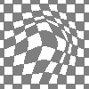</a>      <a href="BMP/tile_chitz.bmp?raw=1">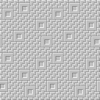</a>  <a href="BMP/tile_cinder_block.bmp?raw=1">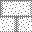</a>    <a href="BMP/tile_circle_weave.bmp?raw=1">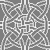</a>    <a href="BMP/tile_circuit.bmp?raw=1">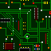</a> 

[Home](README.md) · [1](page1.md) · [2](page2.md) · [3](page3.md) · [4](page4.md) · [5](page5.md) · [6](page6.md)
