# Retro Patterns — Page 2

[Home](README.md) · [1](page1.md) · [2](page2.md) · [3](page3.md) · [4](page4.md) · [5](page5.md) · [6](page6.md)

<a href="BMP/tile_city.bmp?raw=1">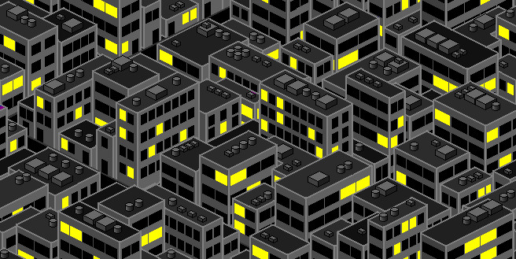</a>   <a href="BMP/tile_cmyk.bmp?raw=1">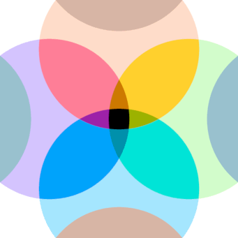</a> <a href="BMP/tile_coffee.bmp?raw=1">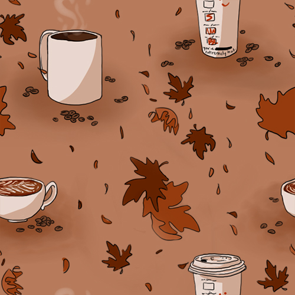</a> <a href="BMP/tile_color-blue.bmp?raw=1">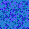</a> <a href="BMP/tile_color-green.bmp?raw=1">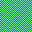</a> <a href="BMP/tile_color-peach.bmp?raw=1">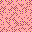</a> <a href="BMP/tile_color-pink.bmp?raw=1">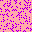</a>     <a href="BMP/tile_color12.bmp?raw=1">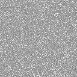</a>   <a href="BMP/tile_color15.bmp?raw=1">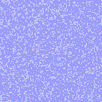</a> <a href="BMP/tile_color16.bmp?raw=1">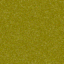</a>     <a href="BMP/tile_color111.bmp?raw=1">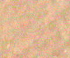</a> <a href="BMP/tile_color114.bmp?raw=1">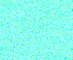</a> <a href="BMP/tile_color115.bmp?raw=1">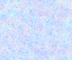</a> <a href="BMP/tile_color137.bmp?raw=1">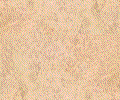</a> <a href="BMP/tile_color139.bmp?raw=1">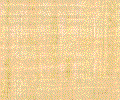</a> <a href="BMP/tile_color142.bmp?raw=1">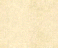</a> <a href="BMP/tile_color150.bmp?raw=1">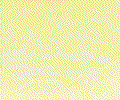</a> <a href="BMP/tile_color157.bmp?raw=1">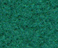</a> <a href="BMP/tile_color158.bmp?raw=1">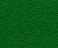</a> <a href="BMP/tile_connections.bmp?raw=1">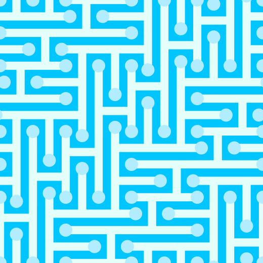</a> <a href="BMP/tile_corn.bmp?raw=1">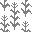</a>             <a href="BMP/tile_diag.bmp?raw=1">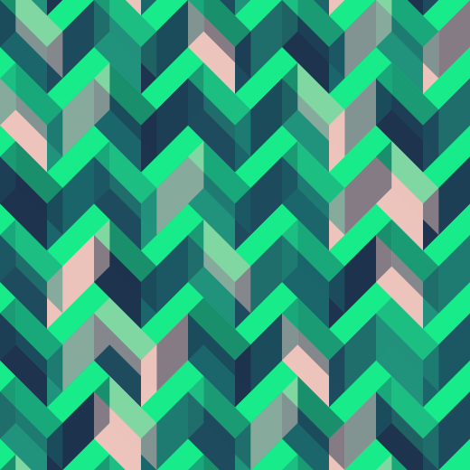</a>   <a href="BMP/tile_dimension.bmp?raw=1">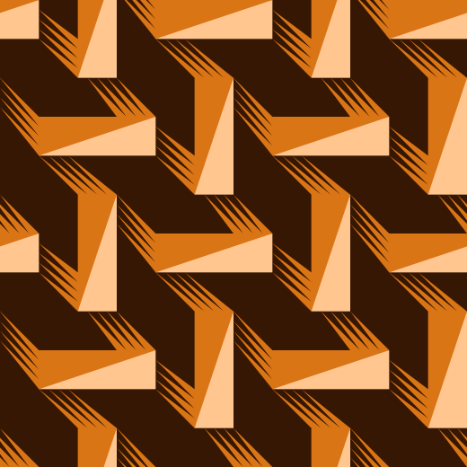</a>  <a href="BMP/tile_donuts.bmp?raw=1">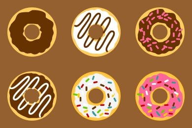</a> <a href="BMP/tile_doodle.bmp?raw=1">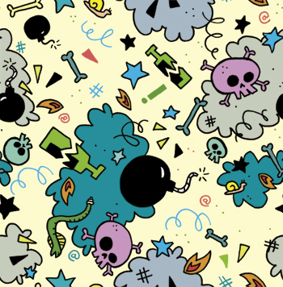</a>           <a href="BMP/tile_dots_stag.bmp?raw=1">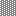</a>   <a href="BMP/tile_dotwave.bmp?raw=1">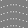</a>            <a href="BMP/tile_escher_fish.bmp?raw=1">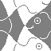</a> <a href="BMP/tile_escher_reptiles.bmp?raw=1">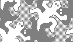</a> <a href="BMP/tile_escher_reptiles2_inv.bmp?raw=1">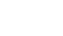</a>  <a href="BMP/tile_escher_swans.bmp?raw=1">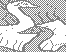</a> <a href="BMP/tile_fallingleaves.bmp?raw=1">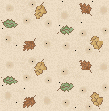</a>        <a href="BMP/tile_fern.bmp?raw=1">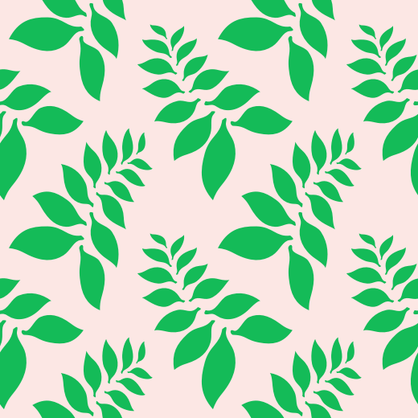</a>  <a href="BMP/tile_Fish.bmp?raw=1">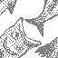</a>  <a href="BMP/tile_flanno.bmp?raw=1">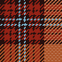</a> <a href="BMP/tile_flies.bmp?raw=1">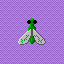</a> <a href="BMP/tile_floral_4.bmp?raw=1">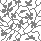</a>  <a href="BMP/tile_floral_6.bmp?raw=1">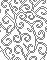</a> <a href="BMP/tile_floutline.bmp?raw=1">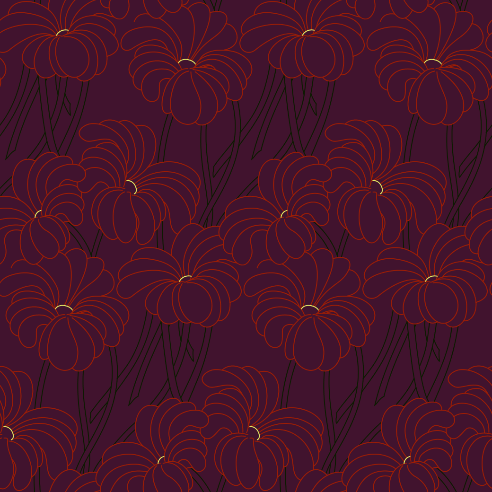</a> 

[Home](README.md) · [1](page1.md) · [2](page2.md) · [3](page3.md) · [4](page4.md) · [5](page5.md) · [6](page6.md)
