# Retro Patterns — Page 3

[Home](README.md) · [1](page1.md) · [2](page2.md) · [3](page3.md) · [4](page4.md) · [5](page5.md) · [6](page6.md)

  <a href="BMP/tile_forest.bmp?raw=1">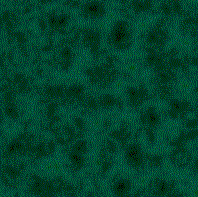</a>     <a href="BMP/tile_geiger.bmp?raw=1">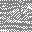</a> <a href="BMP/tile_gemometric.bmp?raw=1">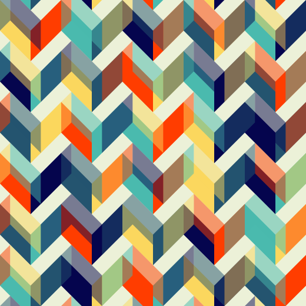</a>    <a href="BMP/tile_grainy.bmp?raw=1">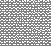</a> <a href="BMP/tile_granite.bmp?raw=1">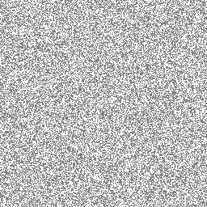</a> <a href="BMP/tile_grass.bmp?raw=1">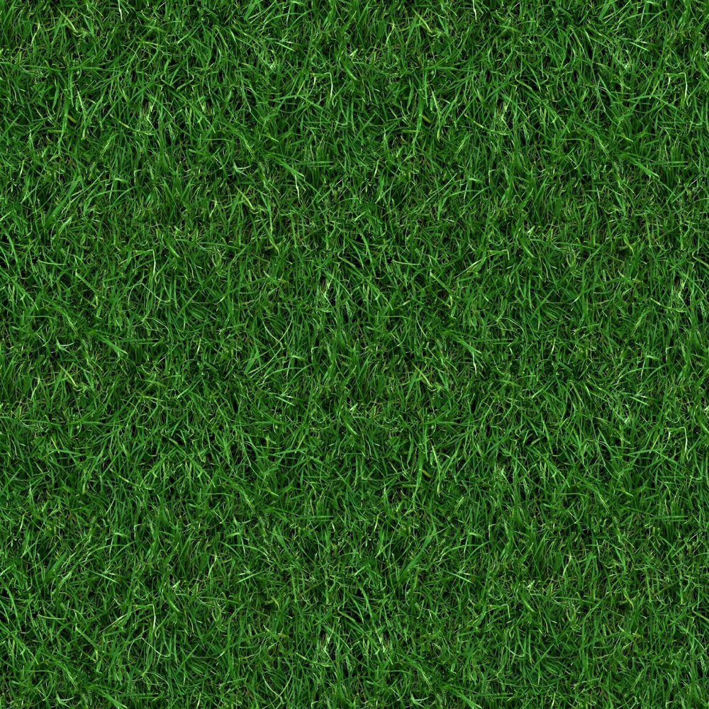</a>  <a href="BMP/tile_greensquared.bmp?raw=1">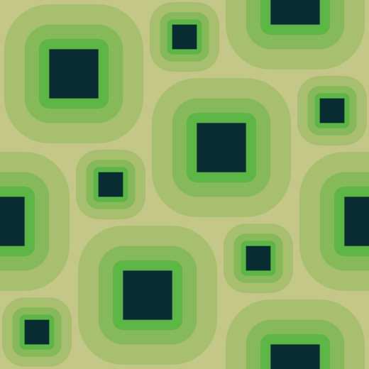</a> <a href="BMP/tile_greenstone.bmp?raw=1">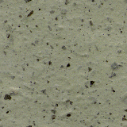</a>            <a href="BMP/tile_grey_32_01.bmp?raw=1">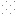</a>              <a href="BMP/tile_grey_32_15.bmp?raw=1">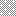</a> <a href="BMP/tile_grey_32_16.bmp?raw=1">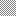</a> <a href="BMP/tile_grey_32_17.bmp?raw=1">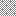</a>    <a href="BMP/tile_grey_32_21.bmp?raw=1">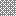</a> <a href="BMP/tile_grey_32_22.bmp?raw=1">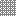</a> <a href="BMP/tile_grey_32_23.bmp?raw=1">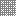</a>    <a href="BMP/tile_grey_32_27.bmp?raw=1">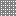</a>            <a href="BMP/tile_grid4.bmp?raw=1">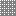</a> <a href="BMP/tile_grid8.bmp?raw=1">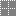</a>   <a href="BMP/tile_groovyflowers.bmp?raw=1">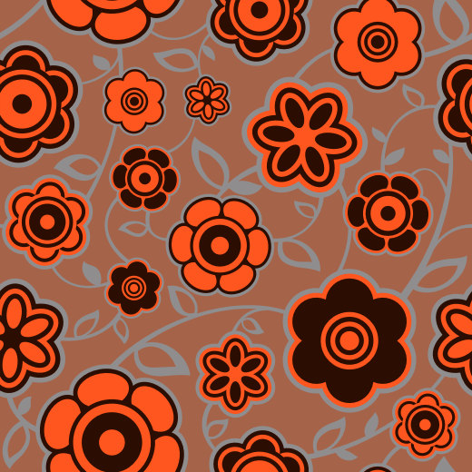</a>          <a href="BMP/tile_hexmaze_inv.bmp?raw=1">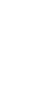</a> <a href="BMP/tile_hexmaze.bmp?raw=1">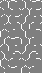</a> <a href="BMP/tile_honey.bmp?raw=1">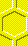</a> <a href="BMP/tile_indig.bmp?raw=1">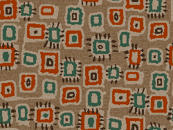</a>    <a href="BMP/tile_ironcoat.bmp?raw=1">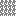</a>  <a href="BMP/tile_java.bmp?raw=1">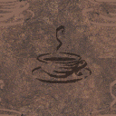</a>   <a href="BMP/tile_jumble.bmp?raw=1">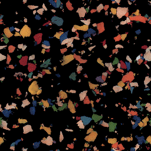</a> <a href="BMP/tile_jungle.bmp?raw=1">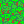</a> <a href="BMP/tile_kapow.bmp?raw=1">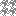</a> <a href="BMP/tile_latice.bmp?raw=1">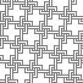</a> <a href="BMP/tile_leaves.bmp?raw=1">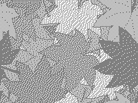</a>   

[Home](README.md) · [1](page1.md) · [2](page2.md) · [3](page3.md) · [4](page4.md) · [5](page5.md) · [6](page6.md)
