# Retro Patterns — Page 4

[Home](README.md) · [1](page1.md) · [2](page2.md) · [3](page3.md) · [4](page4.md) · [5](page5.md) · [6](page6.md)

       <a href="BMP/tile_line_hex_small.bmp?raw=1">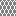</a>             <a href="BMP/tile_line_waves.bmp?raw=1">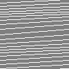</a> <a href="BMP/tile_linen.bmp?raw=1">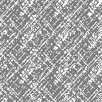</a> <a href="BMP/tile_lino.bmp?raw=1">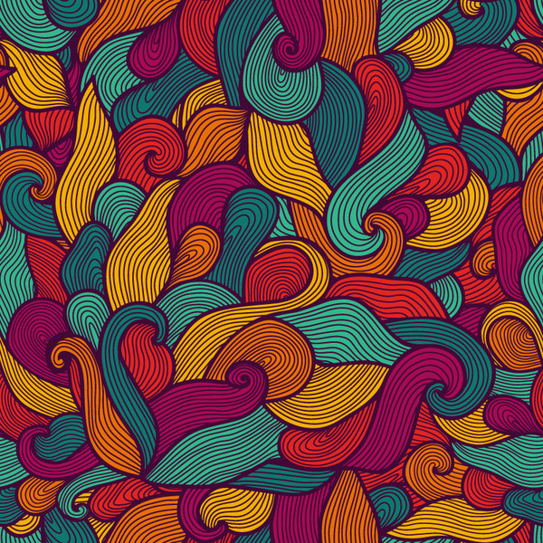</a> <a href="BMP/tile_loops.bmp?raw=1">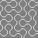</a> <a href="BMP/tile_lozenges-inv.bmp?raw=1">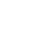</a> <a href="BMP/tile_lozenges.bmp?raw=1">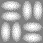</a> <a href="BMP/tile_Madness.bmp?raw=1">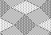</a> <a href="BMP/tile_maple.bmp?raw=1">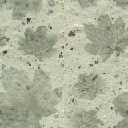</a> <a href="BMP/tile_marble.bmp?raw=1">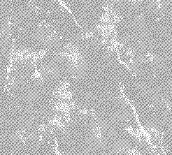</a> <a href="BMP/tile_maze.bmp?raw=1">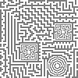</a>   <a href="BMP/tile_mesh_skewed.bmp?raw=1">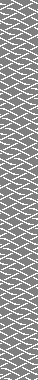</a>    <a href="BMP/tile_modern.bmp?raw=1">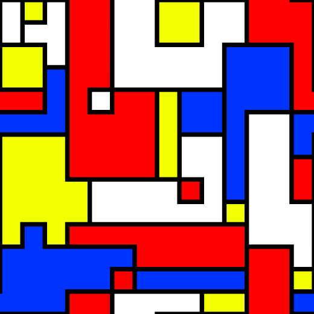</a> <a href="BMP/tile_moor_star.bmp?raw=1">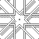</a> <a href="BMP/tile_moor_star2.bmp?raw=1">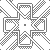</a>  <a href="BMP/tile_oboiii.bmp?raw=1">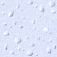</a> <a href="BMP/tile_opart.bmp?raw=1">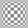</a> <a href="BMP/tile_orange.bmp?raw=1">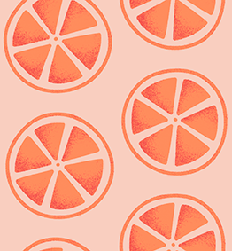</a> <a href="BMP/tile_orangeiterupt.bmp?raw=1">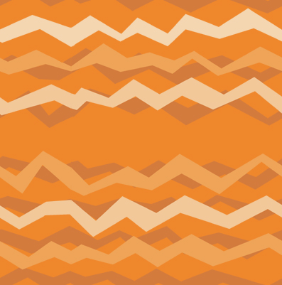</a> <a href="BMP/tile_orangeweave.bmp?raw=1">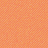</a>  <a href="BMP/tile_overlap.bmp?raw=1">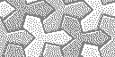</a>  <a href="BMP/tile_pakistan_weave.bmp?raw=1">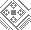</a> <a href="BMP/tile_paperclouds.bmp?raw=1">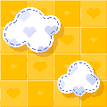</a> <a href="BMP/tile_party.bmp?raw=1">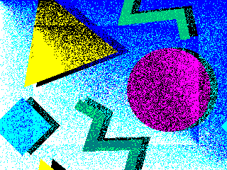</a>     <a href="BMP/tile_pattern-flowers.bmp?raw=1">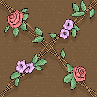</a>   <a href="BMP/tile_pattern-southwest.bmp?raw=1">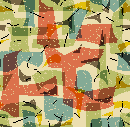</a> <a href="BMP/tile_pattern1.bmp?raw=1">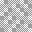</a> <a href="BMP/tile_pattern2.bmp?raw=1">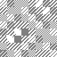</a> <a href="BMP/tile_pattern3.bmp?raw=1">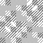</a> <a href="BMP/tile_pdx.bmp?raw=1">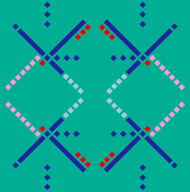</a> <a href="BMP/tile_pegboard.bmp?raw=1">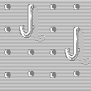</a> <a href="BMP/tile_petroglyph.bmp?raw=1">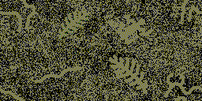</a>  <a href="BMP/tile_pipes.bmp?raw=1">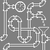</a> <a href="BMP/tile_pixels.bmp?raw=1">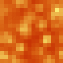</a> <a href="BMP/tile_pixelstars.bmp?raw=1">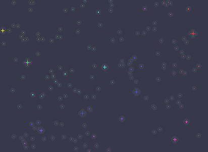</a> <a href="BMP/tile_plaid.bmp?raw=1">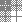</a>    <a href="BMP/tile_planets.bmp?raw=1">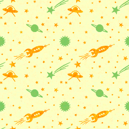</a> <a href="BMP/tile_plasma_maze.bmp?raw=1">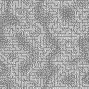</a>      <a href="BMP/tile_raisedpat.bmp?raw=1">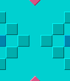</a>   <a href="BMP/tile_random_3.bmp?raw=1">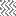</a>   <a href="BMP/tile_redweave.bmp?raw=1">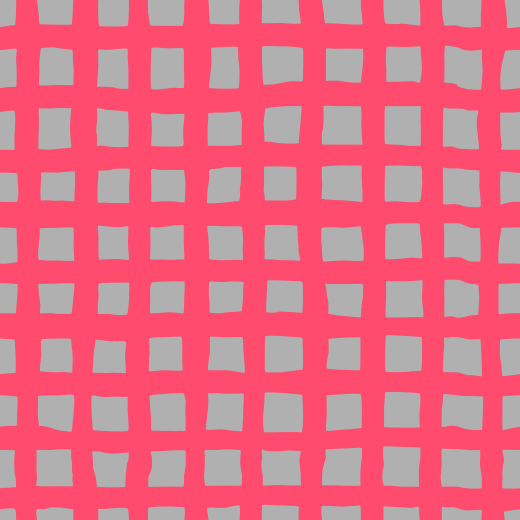</a> <a href="BMP/tile_retrosquares.bmp?raw=1">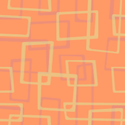</a> <a href="BMP/tile_ribbons.bmp?raw=1">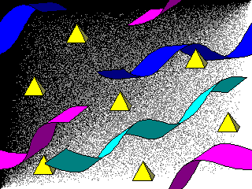</a>    <a href="BMP/tile_rocktiles.bmp?raw=1">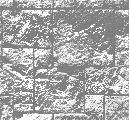</a> <a href="BMP/tile_rods.bmp?raw=1">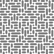</a>    <a href="BMP/tile_Sand_Waves.bmp?raw=1">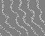</a> <a href="BMP/tile_Sandy_Waves.bmp?raw=1">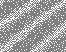</a> <a href="BMP/tile_santafe.bmp?raw=1">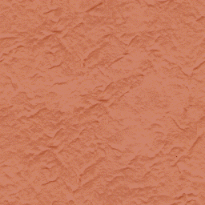</a> 

[Home](README.md) · [1](page1.md) · [2](page2.md) · [3](page3.md) · [4](page4.md) · [5](page5.md) · [6](page6.md)
