# Retro Patterns — Page 5

[Home](README.md) · [1](page1.md) · [2](page2.md) · [3](page3.md) · [4](page4.md) · [5](page5.md) · [6](page6.md)

<a href="BMP/tile_scales.bmp?raw=1">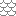</a> <a href="BMP/tile_scatter.bmp?raw=1">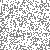</a> <a href="BMP/tile_scorpion.bmp?raw=1">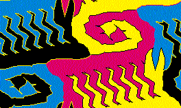</a> <a href="BMP/tile_scribble.bmp?raw=1">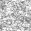</a> <a href="BMP/tile_sea_shells.bmp?raw=1">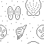</a> <a href="BMP/tile_seaside.bmp?raw=1">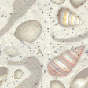</a> <a href="BMP/tile_shapes.bmp?raw=1">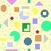</a>    <a href="BMP/tile_slash.bmp?raw=1">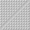</a> <a href="BMP/tile_slime.bmp?raw=1">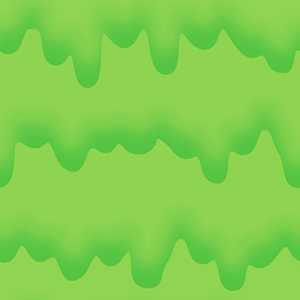</a> <a href="BMP/tile_snake.bmp?raw=1">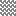</a>  <a href="BMP/tile_southwest.bmp?raw=1">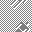</a>   <a href="BMP/tile_speckled.bmp?raw=1">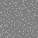</a> <a href="BMP/tile_spheres.bmp?raw=1">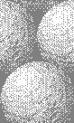</a> <a href="BMP/tile_spin.bmp?raw=1">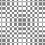</a>    <a href="BMP/tile_splash.bmp?raw=1">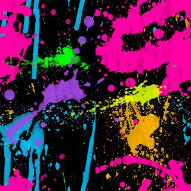</a>    <a href="BMP/tile_spotty-inv.bmp?raw=1">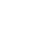</a>  <a href="BMP/tile_spring.bmp?raw=1">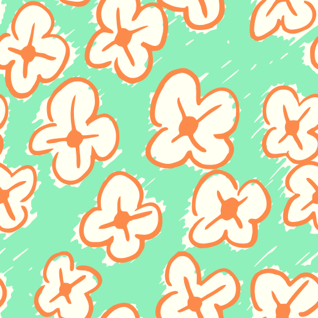</a>     <a href="BMP/tile_squig.bmp?raw=1">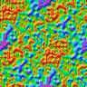</a>  <a href="BMP/tile_squirm.bmp?raw=1">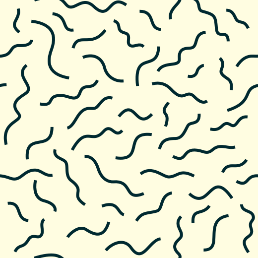</a> <a href="BMP/tile_starrynight.bmp?raw=1">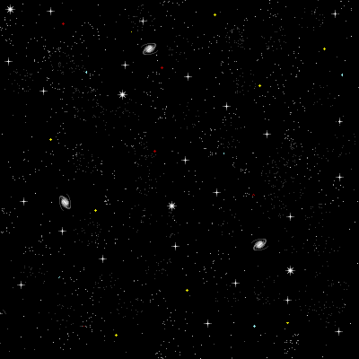</a>  <a href="BMP/tile_steel.bmp?raw=1">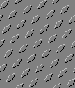</a> <a href="BMP/tile_stich_diag.bmp?raw=1">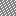</a> <a href="BMP/tile_stich_diag2.bmp?raw=1">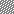</a>  <a href="BMP/tile_stich_vert.bmp?raw=1">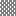</a> <a href="BMP/tile_stones.bmp?raw=1">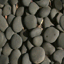</a> <a href="BMP/tile_stucco-blue.bmp?raw=1">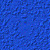</a>  <a href="BMP/tile_subway.bmp?raw=1">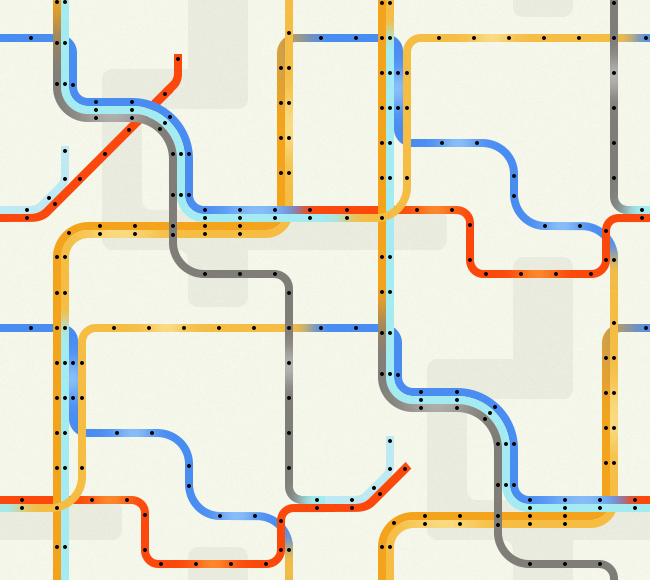</a> <a href="BMP/tile_suntile.bmp?raw=1">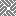</a> <a href="BMP/tile_Swamp.bmp?raw=1">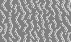</a> <a href="BMP/tile_swirl.bmp?raw=1">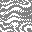</a>  <a href="BMP/tile_tartan.bmp?raw=1">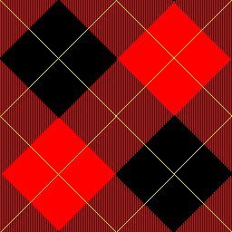</a> <a href="BMP/tile_tellipse.bmp?raw=1">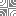</a> <a href="BMP/tile_terracotta.bmp?raw=1">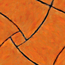</a>  <a href="BMP/tile_tetris2.bmp?raw=1">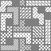</a> <a href="BMP/tile_texture-brown.bmp?raw=1">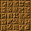</a> <a href="BMP/tile_texture-cyan.bmp?raw=1">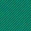</a> <a href="BMP/tile_texture-green.bmp?raw=1">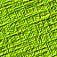</a>  <a href="BMP/tile_tile-cyber.bmp?raw=1">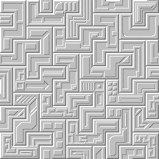</a>   <a href="BMP/tile_tile-sgi.bmp?raw=1">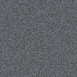</a>    <a href="BMP/tile_toon.bmp?raw=1">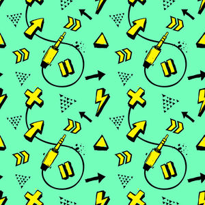</a> <a href="BMP/tile_trees.bmp?raw=1">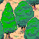</a> <a href="BMP/tile_trelis.bmp?raw=1">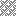</a> <a href="BMP/tile_tripoint.bmp?raw=1">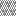</a>  <a href="BMP/tile_turkish_base.bmp?raw=1">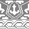</a> <a href="BMP/tile_turkish_flowers.bmp?raw=1">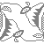</a> <a href="BMP/tile_turkish_hex.bmp?raw=1">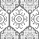</a>   <a href="BMP/tile_tweed_cross.bmp?raw=1">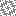</a> <a href="BMP/tile_tweed.bmp?raw=1">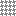</a> <a href="BMP/tile_tweed2_2.bmp?raw=1">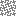</a> <a href="BMP/tile_tweed4_3.bmp?raw=1">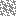</a>                   

[Home](README.md) · [1](page1.md) · [2](page2.md) · [3](page3.md) · [4](page4.md) · [5](page5.md) · [6](page6.md)
