# Retro Patterns — Page 6

[Home](README.md) · [1](page1.md) · [2](page2.md) · [3](page3.md) · [4](page4.md) · [5](page5.md) · [6](page6.md)

<a href="BMP/tile_weave_diag_1.bmp?raw=1">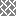</a> <a href="BMP/tile_weave_diag_2.bmp?raw=1">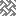</a> <a href="BMP/tile_weave_diag_3.bmp?raw=1">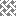</a>   <a href="BMP/tile_weave_diag.bmp?raw=1">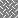</a>   <a href="BMP/tile_weave_rect_long.bmp?raw=1">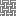</a>    <a href="BMP/tile_weave_rect.bmp?raw=1">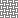</a>    <a href="BMP/tile_weave.bmp?raw=1">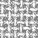</a> <a href="BMP/tile_whichway.bmp?raw=1">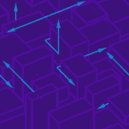</a>  <a href="BMP/tile_winarches.bmp?raw=1">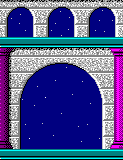</a>  <a href="BMP/tile_winleaves.bmp?raw=1">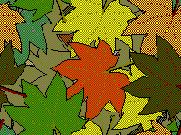</a> <a href="BMP/tile_winmarb.bmp?raw=1">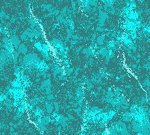</a>   <a href="BMP/tile_wood-floor.bmp?raw=1">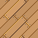</a> <a href="BMP/tile_wood-panels.bmp?raw=1">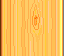</a> <a href="BMP/tile_wood.bmp?raw=1">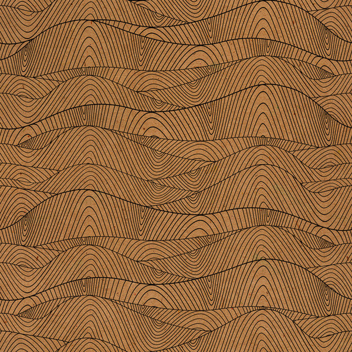</a> <a href="BMP/tile_worngrey.bmp?raw=1">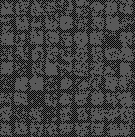</a>  <a href="BMP/tile_wrinkle.bmp?raw=1">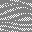</a>  <a href="BMP/tile_yarn.bmp?raw=1">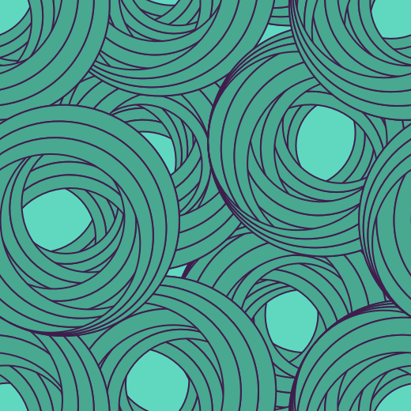</a>   

[Home](README.md) · [1](page1.md) · [2](page2.md) · [3](page3.md) · [4](page4.md) · [5](page5.md) · [6](page6.md)
